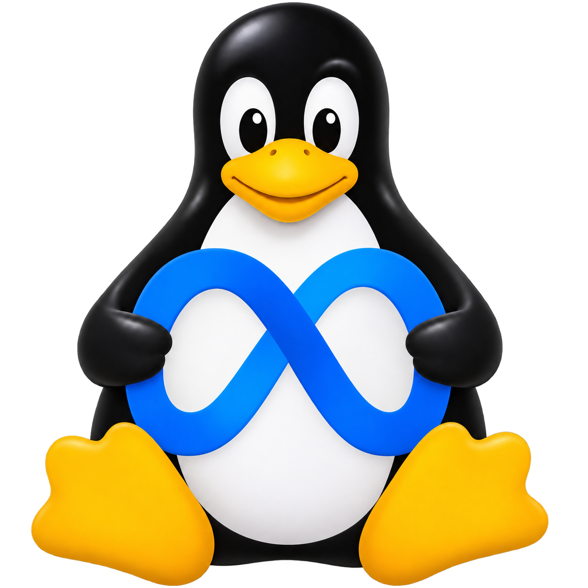
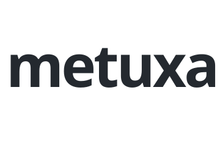
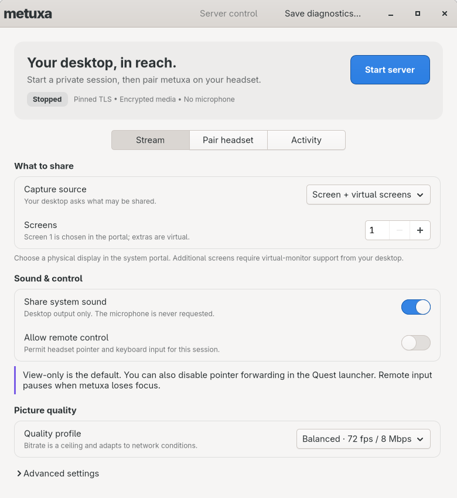
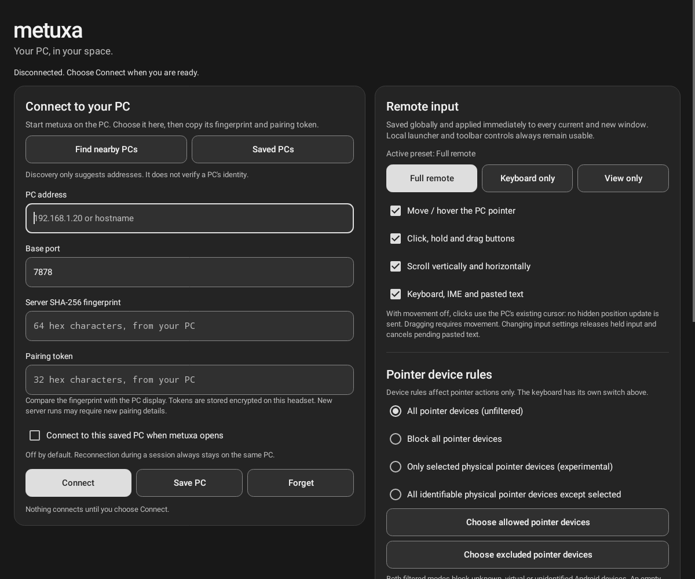

<div align="center">

[**English**](README.md) | [中文](README.zh-CN.md) | [Русский](README.ru.md)

# metuxa

**Your Linux desktop, in reach. In Meta Quest.**

<p align="center">
  
  <picture>
    <source media="(prefers-color-scheme: dark)" srcset="docs/branding/metuxa-wordmark-dark.svg">
    
  </picture>
</p>

[Downloads](https://github.com/romantrnt/metuxa/releases) · [Build](docs/BUILD.md) · [Security](docs/SECURITY.md) · [Contribute](CONTRIBUTING.md)

</div>

metuxa brings your Linux desktop into ordinary, resizable Horizon Home windows. A GTK4 app controls sharing on the PC; a native Android launcher connects your Quest. Choose what to share, pair explicitly, and keep remote input under your control.

It is an independent continuation of [MetaShare](https://github.com/makemake-kbo/metashare), with the original history and MIT attribution preserved.

## A desktop that stays yours

- **Up to three panels.** Share a physical screen and optional virtual displays. A separate, view-only mode shares one application window where the desktop portal supports it.
- **H.265 and H.264.** Hardware encoding when available, software fallback, and adjustable frame rate and bitrate.
- **Sound, once.** Optional system audio plays through the primary panel. No microphone capture.
- **Deliberate input.** View-only on the server by default. Movement, clicks, scroll and keyboard have independent, shared controls across Quest panels.
- **Explicit pairing.** Certificate-pinned TLS, a fresh secret for each server run, authenticated encrypted media and no plaintext fallback.
- **Local connection.** Direct PC-to-headset streaming on your network, without a cloud relay or an account service.

<details>
<summary><strong>The desktop control panel</strong></summary>

<p align="center">
  
</p>

The stopped state from an isolated UI test. No desktop content is being captured.

</details>

<details>
<summary><strong>The Quest launcher</strong></summary>

<p align="center">
  
</p>

Actual Android View rendering in an isolated test, not a headset capture. No address or pairing secret has been entered.

</details>

## Start here

See [Releases](https://github.com/romantrnt/metuxa/releases) for available downloads, checksums and version-specific installation notes. Use matching Linux and Quest versions. AppImage portability, APK signing and tested platforms are release-specific; a source checkout alone is not a verified binary package.

You need:

- A Linux Wayland desktop with PipeWire and a compatible screen-capture portal. Remote control, application-window capture and virtual displays depend on the desktop's portal/compositor support.
- A Meta Quest headset with a compatible Horizon OS runtime. The APK targets ARM64 and requires Android API 32 or newer; the manifest declares Quest 3 and Quest Pro. This is a 2D Android app, not an OpenXR runtime.
- A reachable local network between the PC and headset. A good wireless connection matters more than a high frame-rate setting.

### Pair and share

1. Open **metuxa** on Linux. Start with one screen and the **Balanced** quality profile. Choose system sound and enable **Allow remote control** before starting if you want it.
2. Click **Start server** and choose what to share in the desktop permission dialog. Input works only if the desktop grants it. Cancelling the dialog cancels that attempt.
3. Open the matching metuxa APK on Quest. Select your PC through discovery or enter its address and base port, normally **7878**.
4. Open **Pair headset** on the PC. Compare the full **SHA-256 fingerprint** and enter it with the **pairing code** on Quest, then connect. A discovery result is not proof of identity.
5. Adjust the panel's input switches as needed. **Disconnect all** closes the headset sessions; **Stop server** ends sharing. Restarting the server changes its fingerprint and code, so saved pairing details must be updated.

Keep the pairing code private. Anyone with that run's pairing details may connect while the server is running. Do not expose metuxa to the public internet or configure router port forwarding.

Default network ports: discovery **UDP 7877**, TLS control **TCP 7878–7880** for panels 1–3, and negotiated UDP ports for encrypted media. Protocol 5 is intentionally incompatible with legacy MetaShare clients.

## Input without surprises

**Full remote**, **Keyboard only**, **View only** and **Custom** presets reflect the actual movement, click, scroll and keyboard switches. A change applies across all panels. With movement disabled, allowed clicks use the PC cursor's existing position; they do not move it first. Host permissions remain the upper limit on remote control.

**Block all pointer devices** stops pointer forwarding from hands, controller rays and a mouse connected to Quest. The PC's own mouse and keyboard, metuxa's controls and Home hand tracking are unaffected. Keyboard forwarding has its own switch.

Horizon OS can expose hands and controller rays as indistinguishable Android events. Physical-device filters are experimental: they cannot promise “hands off, controller rays on.” Opt-in diagnostics collect bounded device metadata, not text, coordinates, pixels or audio. See the [Quest guide](client/quest/README.md) for the full input model.

## Build from source

Native dependencies: a C++20 compiler, Meson/Ninja, pkg-config, OpenSSL, FFmpeg codec/util/swscale/swresample, PipeWire, **sdbus-c++ 1.5**, **gtkmm 4.10+ / GTK4** and json-glib development files.

```sh
meson setup build -Dportal=enabled -Dmutter=disabled -Dbuildtype=debugoptimized
meson compile -C build
meson test -C build --print-errorlogs
PATH="$PWD/build/src/streamer:$PATH" ./build/client/gtk/metuxa-control
```

The control app expects `metuxa-server` beside it or on `PATH`; the last command adds the server from the uninstalled build.

For Quest, use JDK 17, Gradle 8.7 and Android SDK platform/build-tools 34:

```sh
cd client/quest
gradle --no-daemon :app:assembleDebug :app:lintDebug :app:testCore
```

`assembleDebug` produces a debug-signed APK, not a release signature. See [Build instructions](docs/BUILD.md) for setup, optional backends, packaging and test isolation.

## Scope and verification

Automated tests cover protocol parsing, input lifecycle, authenticated transport, cross-language interoperability, process supervision and synthetic streaming. They do not establish real-headset latency, comfort, hardware codec reliability or portal compatibility. Read the [verification record](docs/VERIFICATION.md) and [live acceptance checklist](docs/MANUAL-TESTS.md) for what was and was not tested.

The media transport uses standard TLS and AES-GCM primitives in an application-specific protocol. It has **not received an independent security audit**. Use a trusted local network and read the [security model](docs/SECURITY.md). Vulnerability reporting guidance is in [SECURITY.md](SECURITY.md).

The app interfaces are currently English. These README translations cover the documentation only. There is no internet relay, unattended server service or supported microphone forwarding.

## Project map

- `client/gtk/`: Linux control panel and process supervision.
- `client/quest/`: Android launcher, panels, input policies and media client.
- `src/streamer/`: Capture, encoding and authenticated streaming server.
- `tests/`: Protocol, input, security and synthetic integration checks.
- `docs/`: Build, security, verification and live test guides.

See [CONTRIBUTING.md](CONTRIBUTING.md) for development and review expectations.

## Credits and license

metuxa continues [MetaShare](https://github.com/makemake-kbo/metashare) from commit [`ed13beb`](https://github.com/makemake-kbo/metashare/commit/ed13beb32a705c268a9cfd5ac3c055c9e4ada433). The original **MIT** copyright and license are preserved in [LICENSE](LICENSE).

Dependencies and bundled binaries retain their own licenses. In particular, GPL-enabled FFmpeg and x264 can impose GPL obligations on the combined binary distribution; the MIT source license does not replace those obligations. See [Third-party notices](THIRD-PARTY-NOTICES.md).

metuxa is an independent project and is not affiliated with or endorsed by Meta. Meta and Quest names and marks belong to their respective owners.
