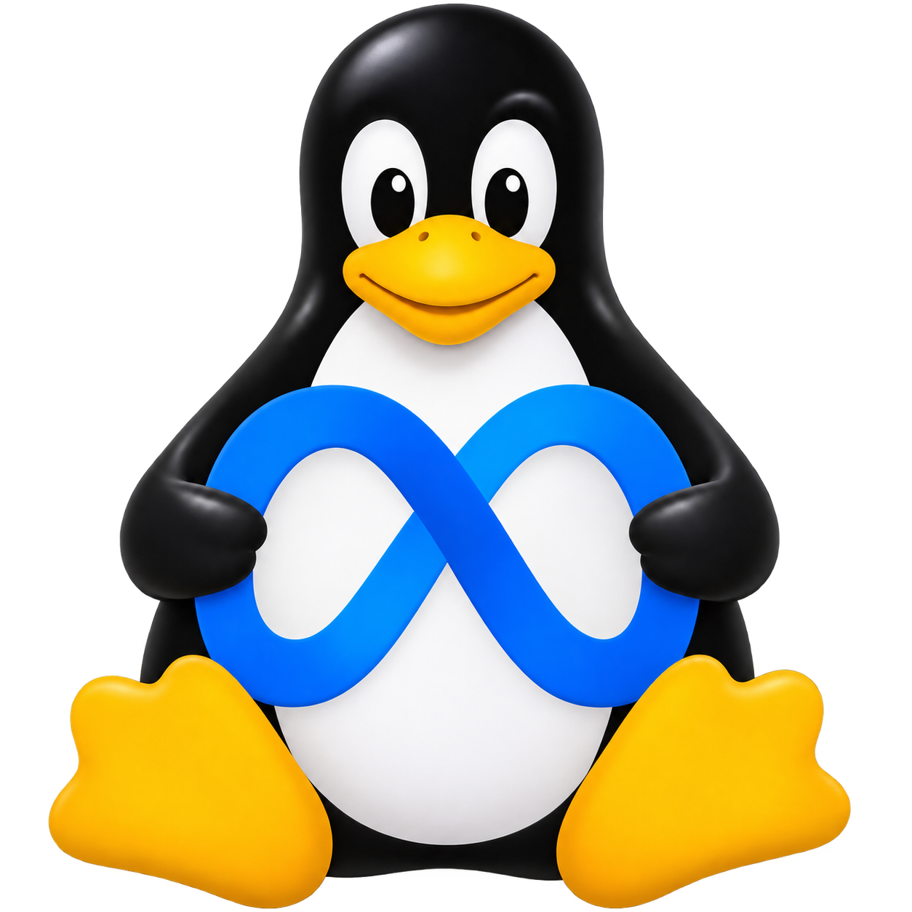
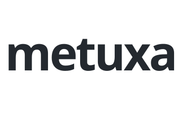
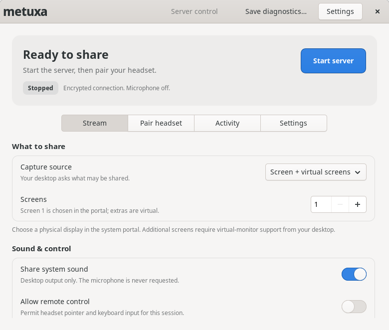
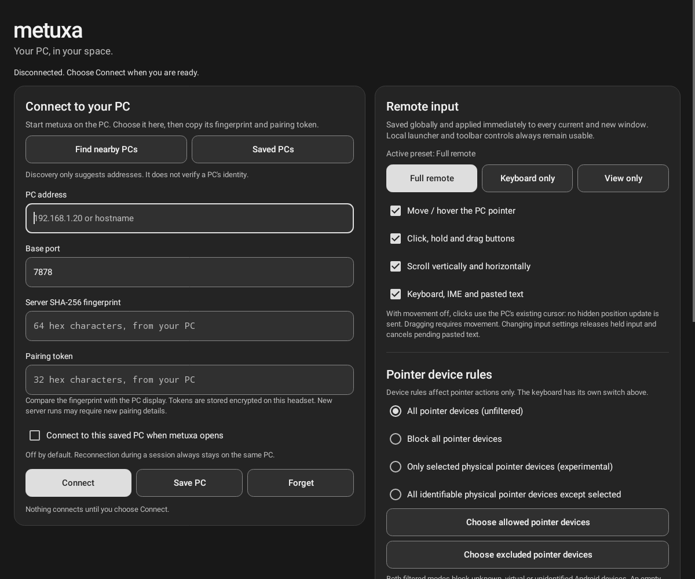

<div align="center">

[English](README.md) | [中文](README.zh-CN.md) | [**Русский**](README.ru.md)

# metuxa

**Рабочий стол Linux рядом. В Meta Quest.**

<p align="center">
  
  <picture>
    <source media="(prefers-color-scheme: dark)" srcset="docs/assets/metuxa-wordmark-dark.svg">
    
  </picture>
</p>

[Скачать](https://github.com/romantrnt/metuxa/releases) · [Сборка](docs/BUILD.md) · [Безопасность](docs/SECURITY.md) · [Участие](CONTRIBUTING.md)

</div>

metuxa переносит рабочий стол Linux в обычные окна Horizon Home, размер которых можно менять. Приложение на GTK4 управляет трансляцией на ПК, а нативный Android-лаунчер подключает Quest. Вы выбираете, что показывать, явно подтверждаете подключение и управляете удалённым вводом.

Это независимое продолжение [MetaShare](https://github.com/makemake-kbo/metashare) с сохранённой историей и исходной атрибуцией MIT.

## Рабочий стол остаётся вашим

- **До трёх панелей.** Физический экран и дополнительные виртуальные дисплеи. Отдельный режим только для просмотра передаёт одно окно приложения, если это поддерживает портал рабочего стола.
- **H.265 и H.264.** Аппаратное кодирование при наличии поддержки, программный резервный вариант, настройка частоты кадров и битрейта.
- **Звук без дублирования.** Системный звук по желанию воспроизводится только в основной панели. Захвата микрофона нет.
- **Управляемый ввод.** По умолчанию сервер работает только на просмотр. Движение, нажатия, прокрутка и клавиатура настраиваются независимо и сразу для всех панелей Quest.
- **Явное сопряжение.** TLS с проверкой отпечатка сертификата, новый секрет при каждом запуске сервера, шифрование и аутентификация медиапакетов без перехода на открытое соединение.
- **Локальное подключение.** Прямая трансляция с ПК на шлем по вашей сети, без облачного ретранслятора и сервиса аккаунтов.

<details>
<summary><strong>Панель управления на ПК</strong></summary>

<p align="center">
  
</p>

Состояние остановленного сервера в изолированном тесте интерфейса. Захват рабочего стола не выполняется.

</details>

<details>
<summary><strong>Лаунчер Quest</strong></summary>

<p align="center">
  
</p>

Рендер настоящих Android View в изолированном тесте, не снимок с гарнитуры. Адрес и секрет сопряжения не введены.

</details>

## С чего начать

Доступные файлы, контрольные суммы и инструкции для конкретной версии находятся в [Releases](https://github.com/romantrnt/metuxa/releases). Используйте совместимые версии Linux-приложения и APK. Переносимость AppImage, подпись APK и проверенные платформы зависят от релиза: наличие исходников само по себе не означает, что бинарный пакет проверен.

Вам понадобятся:

- Linux с Wayland, PipeWire и совместимым порталом захвата экрана. Удалённое управление, захват отдельного окна и виртуальные дисплеи зависят от портала и композитора.
- Meta Quest с совместимой версией Horizon OS. APK рассчитан на ARM64 и Android API 32 или новее; в манифесте указаны Quest 3 и Quest Pro. Это обычное 2D-приложение Android, а не среда OpenXR.
- Локальная сеть, в которой ПК и шлем доступны друг другу. Хорошее беспроводное соединение важнее высокой частоты кадров в настройках.

### Подключение и трансляция

1. Откройте **metuxa** на Linux. Начните с одного экрана и профиля **Balanced**. Выберите системный звук и, если нужно управление, включите **Allow remote control** до запуска.
2. Нажмите **Start server** и выберите источник в системном диалоге разрешений. Ввод работает только при разрешении рабочего стола. Отмена диалога отменяет эту попытку запуска.
3. Откройте соответствующий APK metuxa на Quest. Выберите ПК через поиск или введите его адрес и базовый порт, обычно **7878**.
4. На ПК откройте **Pair headset** и нажмите **Pair a headset**. Подключитесь с Quest, сверьте все десять цифр и подтвердите совпадение на обоих устройствах. Отклоняйте неожиданные запросы. Окно сопряжения закрывается после одной попытки или через минуту. Для старого клиента осталось **Manual pairing** с полным отпечатком и секретом.
5. Настройте переключатели ввода в панели. **Disconnect all** завершает сеансы на шлеме, **Stop server** останавливает трансляцию. После перезапуска сервера выполните сопряжение заново.

Не публикуйте код сопряжения. Пока сервер работает, подключиться может любой, кому известны данные сопряжения этого запуска. Не открывайте metuxa в интернет и не настраивайте проброс портов на роутере.

Порты по умолчанию: обнаружение **UDP 7877**, управление по TLS **TCP 7878–7880** для панелей 1–3 и согласуемые UDP-порты для зашифрованного медиапотока. Протокол 5 намеренно несовместим со старыми клиентами MetaShare.

## Настройки и обновления

Кнопка **Settings** есть на ПК и Quest. Верхняя и нижняя панели на Quest настраиваются отдельно: показывать всегда, при наведении или скрывать через несколько секунд. Кнопка **Controls** остаётся доступной и закрепляет панели для управления руками или контроллером. Физический монитор отображается в той же ориентации, что и на ПК. Поддерживаемый виртуальный монитор можно переключить между горизонтальным и вертикальным: меняется разрешение рабочего стола, окна перестраиваются, а содержимое остаётся прямым. Меняется только выбранный виртуальный монитор. Подробности и ограничения: [ориентация мониторов](docs/ORIENTATION.md).

Перед открытием первой панели Quest получает разрешение по проверенному соединению, не запуская медиапоток, и передаёт системе желаемые пропорции окна. Если эта короткая проверка недоступна, используются сохранённые размеры или горизонтальный размер по умолчанию. Окончательный размер внешнего окна выбирает Horizon; система может сохранить ранее выбранный размер или проигнорировать подсказки приложения. Тема **System** на ПК следует настройке оформления рабочего стола, в том числе при изменениях во время работы приложения. Доступны также размер текста и параметры подключения.

GitHub хранит подписанные обновления. Можно проверять их вручную, получать уведомления или автоматически скачивать. Установка запускается отдельно: Android показывает системное подтверждение, AppImage сохраняет предыдущий файл. Свой сервер и аккаунт не нужны.

Версии 0.3.0 и 0.4.0 могут скачать подписанное обновление до 0.4.1; установку нужно подтвердить отдельно. С 0.2.0 переход на 0.4.1 выполняется вручную, поскольку в старой версии нет обновлятора. Устанавливайте release-подписанный APK поверх прежнего, без удаления данных. Идентификатор остаётся `dev.metuxa.quest`. Версия 0.4.1 использует постоянное имя в библиотеке **metuxa**, а версию показывают внутри приложения. В опубликованных APK 0.4.0 и более ранних версия ещё входит в имя. Horizon может сохранять старое название или показывать package ID; приложение не гарантирует немедленное обновление библиотеки. Подробности: [обновления](docs/UPDATES.md).

## Предсказуемый ввод

Профили **Full remote**, **Keyboard only**, **View only** и **Custom** отражают реальные настройки движения, нажатий, прокрутки и клавиатуры. Изменение действует во всех панелях. При отключённом движении разрешённые нажатия происходят в текущей позиции курсора ПК, без его предварительного перемещения. Разрешения рабочего стола всегда ограничивают возможности удалённого ввода.

**Block all pointer devices** блокирует передачу событий указателя от рук, лучей контроллеров и мыши, подключённой к Quest. Собственные мышь и клавиатура ПК, элементы управления metuxa и отслеживание рук в Home не меняются. Для клавиатурного ввода есть отдельный переключатель.

Horizon OS может представлять руки и лучи контроллеров одинаковыми событиями Android. Фильтры физических устройств экспериментальные: они не гарантируют режим «руки выключены, лучи контроллеров включены». Включаемая вручную диагностика собирает ограниченный объём метаданных устройств, но не текст, координаты, изображение или звук. Полная модель ввода описана в [руководстве Quest](client/quest/README.md).

## Сборка из исходников

Зависимости Linux: компилятор C++20, Meson/Ninja, pkg-config, OpenSSL, libcurl, FFmpeg codec/util/swscale/swresample, PipeWire, **sdbus-c++ 1.5**, **gtkmm 4.10+ / GTK4** и файлы разработки json-glib.

```sh
meson setup build -Dportal=enabled -Dmutter=disabled -Dbuildtype=debugoptimized
meson compile -C build
meson test -C build --print-errorlogs
PATH="$PWD/build/src/streamer:$PATH" ./build/client/gtk/metuxa-control
```

Панель ищет `metuxa-server` рядом с собой или в `PATH`; последняя команда добавляет сервер из каталога сборки.

Для Quest нужны JDK 17, Gradle 8.7 и Android SDK platform/build-tools 34:

```sh
cd client/quest
gradle --no-daemon :app:assembleDebug :app:lintDebug :app:testCore
```

`assembleDebug` создаёт APK с отладочной подписью, а не релизной. Настройка окружения, дополнительные бэкенды, упаковка и изоляция тестов описаны в [инструкции по сборке](docs/BUILD.md).

## Границы возможностей и проверки

Автоматические тесты проверяют разбор протокола, жизненный цикл ввода, защищённый транспорт, взаимодействие Java и C++, управление процессами и синтетическую трансляцию. Они не подтверждают задержку на реальном шлеме, комфорт, надёжность аппаратных кодеков или совместимость портала. Что проверено и что осталось проверить, указано в [отчёте](docs/VERIFICATION-0.4.1.md) и [чек-листе живых тестов](docs/MANUAL-TESTS.md).

Медиатранспорт использует стандартные TLS и AES-GCM в собственном протоколе приложения. **Независимого аудита безопасности не было.** Работайте в доверенной локальной сети и прочитайте [модель безопасности](docs/SECURITY.md). О сообщении об уязвимостях: [SECURITY.md](SECURITY.md).

Интерфейсы приложений пока на английском. Переводы README относятся только к документации. Интернет-ретранслятора, фоновой службы для работы без пользователя и поддерживаемой передачи микрофона нет.

## Структура проекта

- `client/gtk/`: панель Linux и управление процессом сервера.
- `client/quest/`: Android-лаунчер, панели, политики ввода и медиаклиент.
- `src/streamer/`: захват, кодирование и защищённый сервер трансляции.
- `tests/`: проверки протокола, ввода, безопасности и синтетической интеграции.
- `docs/`: сборка, безопасность, отчёты и живые тесты.

Требования к изменениям и проверкам: [CONTRIBUTING.md](CONTRIBUTING.md).

## Благодарности и лицензия

metuxa продолжает [MetaShare](https://github.com/makemake-kbo/metashare), начиная с коммита [`ed13beb`](https://github.com/makemake-kbo/metashare/commit/ed13beb32a705c268a9cfd5ac3c055c9e4ada433). Исходное уведомление об авторских правах и лицензия **MIT** сохранены в [LICENSE](LICENSE).

Зависимости и включённые в пакеты бинарные компоненты сохраняют свои лицензии. В частности, FFmpeg с включённой GPL и x264 могут накладывать требования GPL на объединённый бинарный дистрибутив; MIT-лицензия исходников их не отменяет. Подробности: [уведомления о сторонних компонентах](THIRD-PARTY-NOTICES.md).

metuxa: независимый проект, не связанный с Meta и не одобренный ею. Названия и знаки Meta и Quest принадлежат соответствующим правообладателям.
