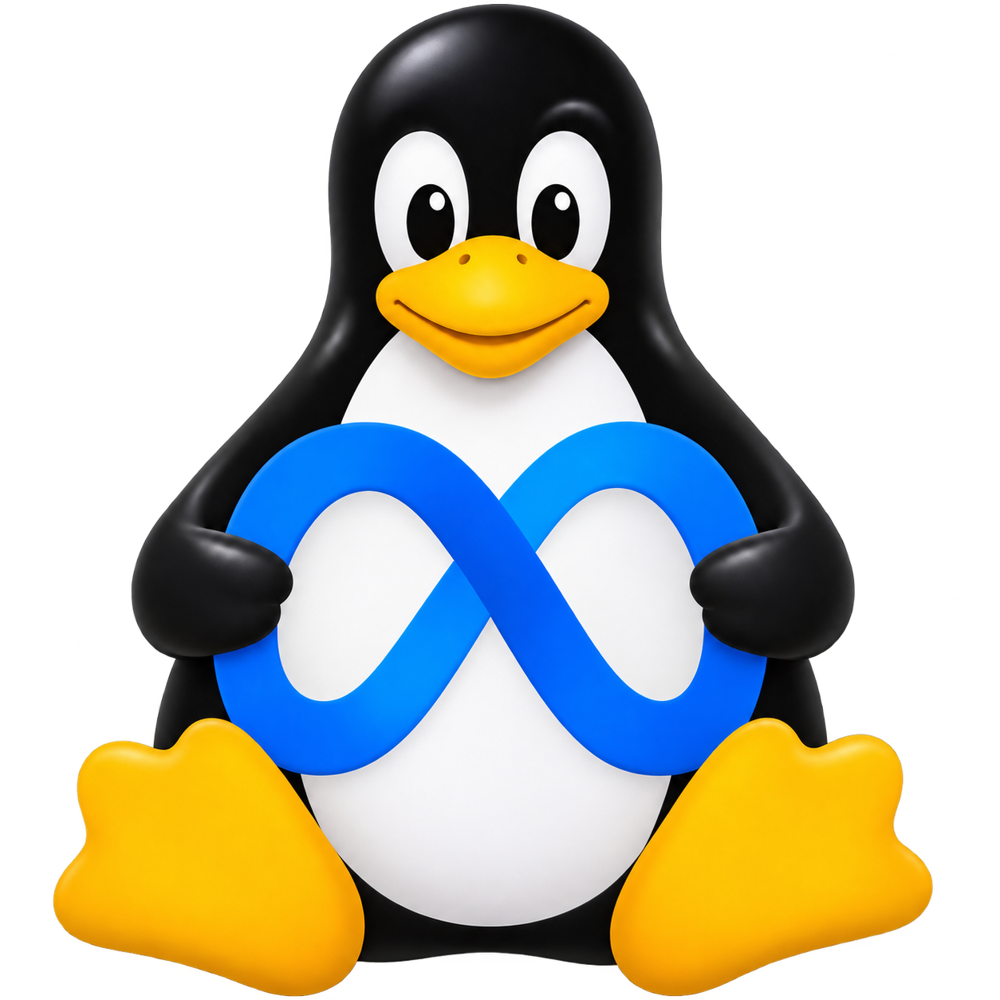
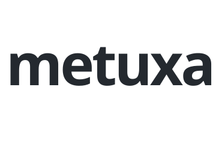
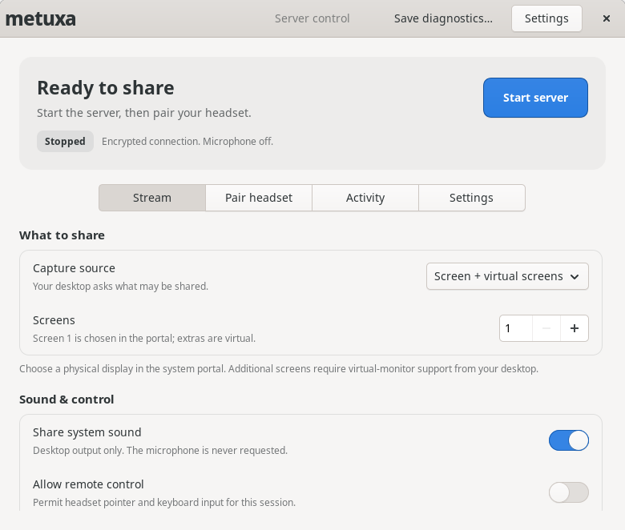
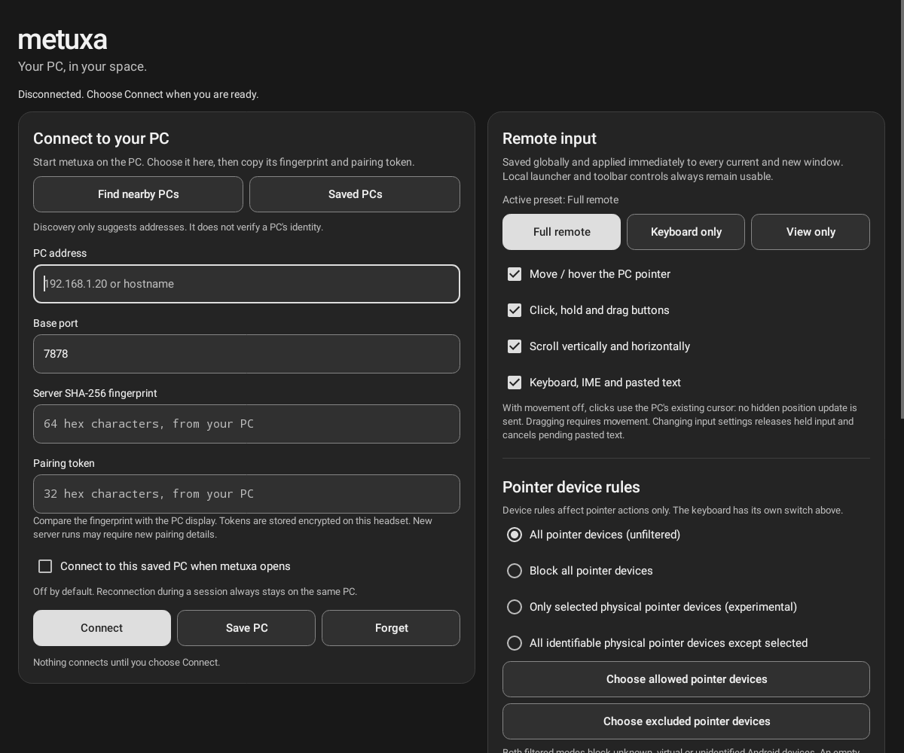

<div align="center">

[English](README.md) | [**中文**](README.zh-CN.md) | [Русский](README.ru.md)

# metuxa

**让 Linux 桌面触手可及。在 Meta Quest 中。**

<p align="center">
  
  <picture>
    <source media="(prefers-color-scheme: dark)" srcset="docs/assets/metuxa-wordmark-dark.svg">
    
  </picture>
</p>

[下载](https://github.com/romantrnt/metuxa/releases) · [构建](docs/BUILD.md) · [安全](docs/SECURITY.md) · [参与贡献](CONTRIBUTING.md)

</div>

metuxa 将 Linux 桌面带入 Horizon Home 中可调整大小的普通窗口。PC 端的 GTK4 应用负责控制共享，Quest 端的原生 Android 启动器负责连接。共享什么、与谁配对、允许哪些远程输入，都由你决定。

本项目独立延续自 [MetaShare](https://github.com/makemake-kbo/metashare)，保留原始 Git 历史和 MIT 版权声明。

## 桌面始终由你掌控

- **最多三个面板。** 共享一个实体屏幕，并可添加虚拟显示器。如果桌面门户支持，也可通过独立的只读模式共享单个应用窗口。
- **H.265 与 H.264。** 优先使用可用的硬件编码，支持软件回退，并可调整帧率与码率。
- **声音只播放一次。** 可选的系统音频仅由主面板播放。不采集麦克风。
- **明确的输入控制。** 服务端默认仅允许查看。移动、点击、滚动和键盘可独立配置，设置在所有 Quest 面板间共享。
- **显式配对。** 固定证书指纹的 TLS、每次启动服务器重新生成的配对密钥、经过身份验证的加密媒体传输，不回退到明文连接。
- **本地直连。** PC 与头显通过你的网络直接传输，无需云端中继或账户服务。

<details>
<summary><strong>桌面控制面板</strong></summary>

<p align="center">
  
</p>

截图来自隔离的界面测试，服务器处于停止状态，没有采集桌面内容。

</details>

<details>
<summary><strong>Quest 启动器</strong></summary>

<p align="center">
  
</p>

隔离测试中的真实 Android View 渲染，并非头显截图。未输入地址或配对密钥。

</details>

## 快速开始

请在 [Releases](https://github.com/romantrnt/metuxa/releases) 查看可用下载、校验和及对应版本的安装说明。Linux 应用与 Quest APK 应使用相匹配的版本。AppImage 的兼容范围、APK 签名和已测试平台取决于具体发行版；源代码仓库本身不代表二进制包已经通过验证。

你需要：

- 使用 Wayland、PipeWire 和兼容屏幕采集门户的 Linux 桌面。远程控制、单窗口采集和虚拟显示器取决于桌面门户及合成器的支持。
- 运行兼容 Horizon OS 的 Meta Quest 头显。APK 面向 ARM64，最低要求为 Android API 32；清单中声明了 Quest 3 和 Quest Pro。这是一个 Android 2D 应用，不是 OpenXR 运行时。
- PC 与头显能互相访问的本地网络。良好的无线连接比调高帧率更重要。

### 配对与共享

1. 在 Linux 上打开 **metuxa**。建议先选择一个屏幕和 **Balanced** 画质预设。选择是否共享系统音频；需要远程控制时，请在启动前启用 **Allow remote control**。
2. 点击 **Start server**，在桌面权限对话框中选择共享内容。只有获得桌面授权后才能使用远程输入。取消对话框会取消本次启动。
3. 在 Quest 上打开对应版本的 metuxa APK。通过发现功能选择 PC，或输入地址与基础端口，通常为 **7878**。
4. 在 PC 上打开 **Pair headset**，点击 **Pair a headset**，然后在 Quest 上连接。核对两端显示的全部十位数字，仅在完全一致时分别确认。拒绝意外请求。配对窗口在一次尝试后或一分钟后关闭。旧客户端仍可通过 **Manual pairing** 输入完整指纹和密钥。
5. 按需调整面板的输入开关。**Disconnect all** 结束头显连接，**Stop server** 停止共享。重新启动服务器会更换指纹和配对码，需要更新已保存的配对信息。

请妥善保管配对码。服务器运行期间，持有该次运行配对信息的人可能连接。请勿将 metuxa 暴露到公网，也不要设置路由器端口转发。

默认端口：设备发现使用 **UDP 7877**，面板 1–3 的 TLS 控制使用 **TCP 7878–7880**，加密媒体使用协商出的 UDP 端口。协议版本 5 有意不兼容旧版 MetaShare 客户端。

## 设置和更新

PC 和 Quest 都有 **Settings**。Quest 的顶部与底部控制栏可分别设为始终显示、悬停显示或延时隐藏。**Controls** 按钮始终可用，方便通过手部或控制器固定显示控制栏。实体显示器保持与 PC 上完全相同的方向。受支持的虚拟显示器可以切换横向或纵向；桌面分辨率随之改变，应用窗口重新布局，内容保持正向。只改变所选虚拟显示器。支持范围与限制请参阅[显示器方向](docs/ORIENTATION.md)。

在打开首个视频面板前，Quest 会通过已验证的连接读取尺寸，不启动媒体传输，然后向系统提供窗口大小提示。如果这次简短检查不可用，则使用已保存的尺寸或默认横向尺寸。外层窗口的最终大小由 Horizon 决定，它可能保留先前选择的尺寸或忽略应用的提示。PC 的 **System** 主题跟随桌面外观偏好，也会响应应用运行期间的变化。设置中还可调整文字大小和连接选项。

更新由 GitHub 托管，并使用发布密钥签名。可手动检查、接收提示或自动下载，安装仍需明确操作。Android 保留系统安装确认，Linux 保留旧 AppImage。0.3.0 可下载已签名的 0.4.0 更新，安装仍需用户确认。0.2.0 没有更新器，升级到 0.4.0 需要手动覆盖安装。请勿为升级而卸载正式签名的 APK。

应用 ID 仍为 `dev.metuxa.quest`。新的源码构建使用固定的库名称 **metuxa**，版本号在应用内显示。已发布的 0.4.0 及更早 APK 的名称仍包含版本号。Horizon 可能保留旧名称或显示包名；应用无法保证库名称立即刷新。详见 [更新说明](docs/UPDATES.md)。

## 可预期的输入行为

**Full remote**、**Keyboard only**、**View only** 和 **Custom** 预设反映移动、点击、滚动和键盘开关的实际状态。修改会同时应用到所有面板。关闭移动后，允许的点击发生在 PC 光标当前的位置，不会先移动光标。远程输入始终受桌面授权范围限制。

**Block all pointer devices** 阻止来自手部、控制器射线和 Quest 所连鼠标的指针转发。不影响 PC 自身的鼠标与键盘、metuxa 的界面控件或 Home 中的手部追踪。键盘转发由独立开关控制。

Horizon OS 可能将手部和控制器射线表示为无法区分的 Android 事件。物理设备过滤属于实验性功能，不能保证“禁用手部、保留控制器射线”。手动开启的诊断只收集有容量限制的设备元数据，不记录文字、坐标、画面或音频。完整的输入模型见 [Quest 指南](client/quest/README.md)。

## 从源码构建

Linux 依赖：C++20 编译器、Meson/Ninja、pkg-config、OpenSSL、libcurl、FFmpeg codec/util/swscale/swresample、PipeWire、**sdbus-c++ 1.5**、**gtkmm 4.10+ / GTK4** 和 json-glib 开发文件。

```sh
meson setup build -Dportal=enabled -Dmutter=disabled -Dbuildtype=debugoptimized
meson compile -C build
meson test -C build --print-errorlogs
PATH="$PWD/build/src/streamer:$PATH" ./build/client/gtk/metuxa-control
```

控制面板会在自身所在目录或 `PATH` 中查找 `metuxa-server`；最后一条命令将构建目录中的服务器加入搜索路径。

Quest 构建需要 JDK 17、Gradle 8.7 和 Android SDK platform/build-tools 34：

```sh
cd client/quest
gradle --no-daemon :app:assembleDebug :app:lintDebug :app:testCore
```

`assembleDebug` 生成的是调试签名 APK，不是正式发行签名。环境配置、可选后端、打包与测试隔离见[构建说明](docs/BUILD.md)。

## 范围与验证

自动化测试覆盖协议解析、输入生命周期、经过身份验证的传输、跨语言互操作、进程管理和合成媒体传输。它们不能证明真实头显的延迟、舒适度、硬件编解码器可靠性或门户兼容性。已测试和未测试的范围见[验证记录](docs/VERIFICATION-0.4.0.md)及[实机验收清单](docs/MANUAL-TESTS.md)。

媒体传输在应用专用协议中使用标准 TLS 和 AES-GCM 原语，**尚未经过独立安全审计**。请在可信的本地网络中使用，并阅读[安全模型](docs/SECURITY.md)。漏洞报告说明见 [SECURITY.md](SECURITY.md)。

应用界面目前为英文。README 翻译仅覆盖文档。不提供互联网中继、无人值守服务或受支持的麦克风转发。

## 项目结构

- `client/gtk/`：Linux 控制面板与进程管理。
- `client/quest/`：Android 启动器、面板、输入策略和媒体客户端。
- `src/streamer/`：采集、编码及经过身份验证的流媒体服务器。
- `tests/`：协议、输入、安全及合成集成测试。
- `docs/`：构建、安全、验证和实机测试指南。

开发与审查要求见 [CONTRIBUTING.md](CONTRIBUTING.md)。

## 致谢与许可证

metuxa 基于 [MetaShare](https://github.com/makemake-kbo/metashare) 的提交 [`ed13beb`](https://github.com/makemake-kbo/metashare/commit/ed13beb32a705c268a9cfd5ac3c055c9e4ada433) 继续开发。原始 **MIT** 版权与许可证保留在 [LICENSE](LICENSE) 中。

依赖项和打包的二进制组件保留各自的许可证。启用 GPL 的 FFmpeg 及 x264 可能对组合二进制发行包施加 GPL 义务；源代码的 MIT 许可证不替代这些义务。详见[第三方声明](THIRD-PARTY-NOTICES.md)。

metuxa 是独立项目，与 Meta 无关联，也未获得 Meta 背书。Meta、Quest 的名称与标志属于各自的权利人。
